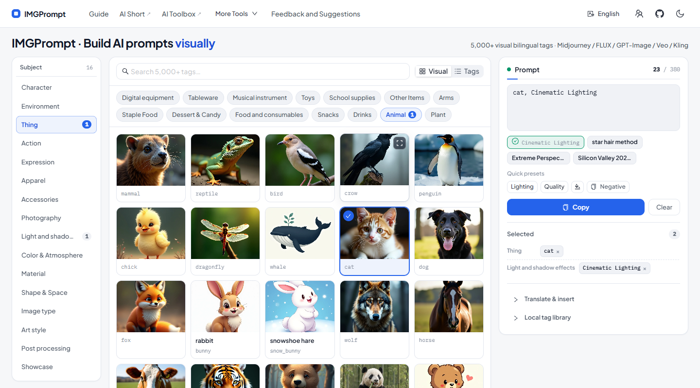

<h1 align="center">⚡️ IMGPrompt</h1>

<p align="center">
Click in your language, copy out the English wording AI image and video models expect.
</p>

<p align="center">
  <a href="https://github.com/rockbenben/img-prompt/releases"></a>
  <a href="https://github.com/rockbenben/img-prompt/blob/main/LICENSE"></a>
</p>

<p align="center">
  <a href="https://prompt.newzone.top/en"><b>▶ Try it online</b></a> ·
  <a href="https://github.com/rockbenben/img-prompt/releases/latest"><b>⬇ Desktop app</b></a> ·
  <a href="https://prompt.newzone.top/en/guide/deploy.html">Self-host guide</a> ·
  <a href="./README.zh.md">简体中文</a>
</p>



You know the look you are after — you just don't know that models call it `Tyndall effect`, `film grain` or `Fisheye Lens`. IMGPrompt is a prompt editor for AI art and video, built for people who don't think in English: it lays 5,000+ of those terms out by subject and category, labelled in your native language and nearly all carrying a preview image. Click the ones you want and the English prompt for GPT-Image-2, Midjourney, FLUX or Veo assembles on the right.

## Supported

| What | Details |
| --- | --- |
| **Target models** | GPT-Image-2 · Nano Banana · Midjourney · FLUX · Seedance · Veo · Kling — also compatible with Stable Diffusion and DALL·E syntax |
| **Languages** | 18, with the interface and the tag library both fully translated ([direct links below](#open-the-app-in-your-language)). Arabic renders right-to-left |
| **Run it in** | Any modern browser, nothing to install · Windows (exe / msi) · macOS (Intel + Apple Silicon) · Linux (deb / AppImage / rpm) |
| **Your data** | There is no backend — the category is in the shareable URL and drafts and imported libraries stay in the browser |
| **Built-in translation** | Multiple providers, including Google, Microsoft Edge, Youdao and MyMemory |

## Quick start

1. Open **[prompt.newzone.top/en](https://prompt.newzone.top/en)**, or install the [desktop app](https://github.com/rockbenben/img-prompt/releases/latest).
2. Pick a **subject** (①) → pick a **category** (②) → click the **tags** you want (③).
3. The English prompt assembles in the right-hand panel as you click. Hit **Copy** and paste it into your AI tool.

Copy the address to share the built-in subject and category. Use **Copy** in the editor to share the prompt text.

## Features

- **Browse or search 5,000+ bilingual tags.** Search English or the current interface language. Switch between **Visual** cards and the compact **Tags** view. Open a card’s preview to inspect the larger image.
- **Edit the prompt directly.** Complete the last entry from suggestions, append lighting or quality presets, copy negative terms, and undo a clear. Refreshing the same tab restores your draft.
- **Import a private tag library.** Open **Local tag library** in the prompt panel to import a JSON file up to 2 MB. Tags appear in categories, search, and suggestions. Removing the library removes its selected tags from the prompt. [JSON format and example](https://prompt.newzone.top/en/guide/data)
- **Translate when needed.** Expand **Translate & insert** to append an English translation. In other interface languages, automatic translation is available as an opt-in.
- **Use the editor on a phone.** After selecting a tag, the mobile bar lets you copy the prompt or jump to the editor.
- **Bundle your own data.** The multilingual library is plain JSON in `src/app/data/prompt/prompt-<locale>.json`.

## Open the app in your language

[English](https://prompt.newzone.top/en) · [中文](https://prompt.newzone.top/zh) · [繁體中文](https://prompt.newzone.top/zh-hant) · [日本語](https://prompt.newzone.top/ja) · [한국어](https://prompt.newzone.top/ko) · [Português](https://prompt.newzone.top/pt) · [Español](https://prompt.newzone.top/es) · [Français](https://prompt.newzone.top/fr) · [Deutsch](https://prompt.newzone.top/de) · [Italiano](https://prompt.newzone.top/it) · [Русский](https://prompt.newzone.top/ru) · [हिन्दी](https://prompt.newzone.top/hi) · [العربية](https://prompt.newzone.top/ar) · [বাংলা](https://prompt.newzone.top/bn) · [Indonesia](https://prompt.newzone.top/id) · [Türkçe](https://prompt.newzone.top/tr) · [Tiếng Việt](https://prompt.newzone.top/vi) · [ไทย](https://prompt.newzone.top/th)

## Limitations

- **The translate box is the one thing that leaves your browser.** What you type there is sent to free public endpoints, using no API key of yours. They rate-limit, and MyMemory refuses anything over 500 bytes — the app falls through the provider list, but a long paragraph can still come back untranslated.
- **Tag preview images are served from a CDN.** The tag data itself ships with the app, but the built-in preview images need a network connection, including in the desktop build.

## Self-host

The published image carries the finished 18-language site, so there is nothing to build:

```bash
docker run -d -p 5666:5666 --name imgprompt ghcr.io/rockbenben/img-prompt:latest
```

Open `http://localhost:5666` and it is yours — on a NAS, a home server, or an air-gapped machine. A `docker-compose.yml` ships in the repo, and because the app is a plain static export, any static host works just as well. Node versions, build commands and Vercel steps are in the [deployment guide](https://prompt.newzone.top/en/guide/deploy.html).

## Contributing

Tag contributions are the most useful kind, and they need no toolchain: every language is one JSON file under `src/app/data/prompt/`, so adding or correcting a term for your language is a single edit. For code, the stack is Next.js 16 + React 19 + TypeScript with Ant Design 6 and Tailwind CSS 4 — open an issue first if the change is a large one.

## Star History

<a href="https://star-history.com/#rockbenben/img-prompt&Date">
  <picture>
    <source media="(prefers-color-scheme: dark)" srcset="https://star-history.dera.page/svg?repos=rockbenben/img-prompt&type=Date&theme=dark" />
    <source media="(prefers-color-scheme: light)" srcset="https://star-history.dera.page/svg?repos=rockbenben/img-prompt&type=Date" />
    
  </picture>
</a>

## Credits and licensing

IMGPrompt's own code is [MIT](LICENSE). The prompt library is aggregated and curated from several open sources — huge thanks to:

- [EvoLinkAI/awesome-gpt-image-2-prompts](https://github.com/EvoLinkAI/awesome-gpt-image-2-prompts) — GPT-Image-2 prompt examples, licensed under [CC BY 4.0](https://creativecommons.org/licenses/by/4.0/). Entries are localized into 18 languages; per-entry author credits are preserved in the data file.
- [Physton/sd-webui-prompt-all-in-one](https://github.com/Physton/sd-webui-prompt-all-in-one) — baseline tag taxonomy (AGPL-3.0).
- [promptoMANIA](https://promptomania.com/midjourney-prompt-builder/) — structured keyword inspiration.
