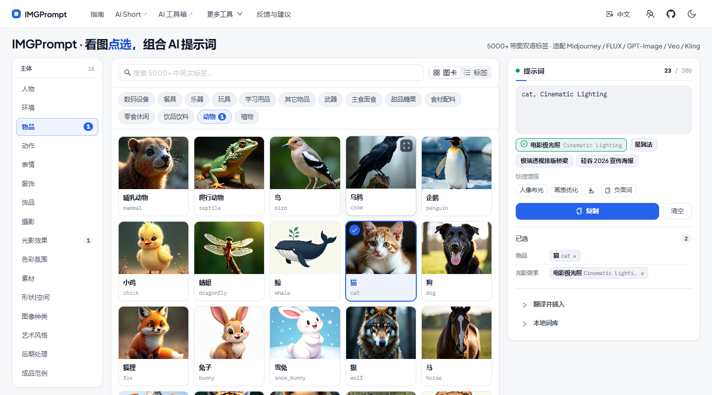

<h1 align="center">⚡️ IMGPrompt</h1>

<p align="center">
中文点标签，英文出提示词，AI 绘画/视频通用。
</p>

<p align="center">
  <a href="https://github.com/rockbenben/img-prompt/releases"></a>
  <a href="https://github.com/rockbenben/img-prompt/blob/main/LICENSE"></a>
</p>

<p align="center">
  <a href="https://prompt.newzone.top/zh"><b>▶ 在线体验</b></a> ·
  <a href="https://github.com/rockbenben/img-prompt/releases/latest"><b>⬇ 桌面客户端</b></a> ·
  <a href="https://prompt.newzone.top/zh/guide/deploy.html">自部署文档</a> ·
  <a href="./README.md">English</a>
</p>



你想要的是「丁达尔效应」「胶片颗粒」「鱼眼镜头」，模型认的却是 Tyndall effect、film grain、Fisheye Lens。IMGPrompt 是一款给非英语母语者做的提示词编辑器，把 5000 多组这样的对照按主体和类别铺成一面标签墙，几乎每条都配了示意图——点你要的，右侧实时拼出 GPT-Image-2、Midjourney、FLUX、Veo 认得的英文提示词。打开网页就能用。

## 支持范围

| 维度 | 支持情况 |
| --- | --- |
| **目标模型** | GPT-Image-2 · Nano Banana · Midjourney · FLUX · Seedance · Veo · Kling，同时兼容 Stable Diffusion、DALL·E 语法 |
| **语言** | 18 种，界面与提示词库全量翻译（[直达入口见下](#各语言直达入口)）。阿拉伯语自动右向左渲染 |
| **运行方式** | 浏览器免安装即用 · Windows · macOS（Intel + Apple Silicon） · Linux（deb / AppImage / rpm） |
| **数据去向** | 没有后端——分类由链接分享，草稿和导入的词库保存在浏览器里 |
| **内置翻译** | 支持 Google、微软 Edge、有道和 MyMemory 等服务 |

## 快速开始

1. 打开 **[prompt.newzone.top/zh](https://prompt.newzone.top/zh)**，或安装[桌面客户端](https://github.com/rockbenben/img-prompt/releases/latest)。
2. 选**主体**（①）→ 选**类别**（②）→ 点击你要的**标签**（③）。
3. 英文提示词会随点击实时拼进右侧面板，点**复制**，粘贴到 AI 工具即可。

复制地址即可分享当前内置主体和类别。分享提示词文本请用编辑器里的**复制**。

## 功能亮点

- **浏览或搜索 5000 多条双语标签。** 支持英文和当前界面语言，可在带缩略图的**可视化**视图和紧凑的**标签**视图间切换。点击卡片的预览按钮可查看大图。
- **直接编辑提示词。** 用建议补全末尾词条，可追加光照和画质预设、复制负面词，也可撤销清空。同一标签页刷新后会恢复草稿。
- **导入私有词库。** 在提示词面板展开**本地词库**，可导入不超过 2 MB 的 JSON 文件。导入词条会出现在分类、搜索和建议里。移除词库会一并移除提示词中选自该词库的词条。[JSON 格式与示例](https://prompt.newzone.top/zh/guide/data)
- **按需翻译。** 展开**翻译并插入**可将英文译文追加到提示词。非英语界面的自动译文默认关闭。
- **手机快捷操作。** 选词后可通过底栏复制提示词或跳到编辑器。
- **可随构建打包自定义数据。** 内置多语言词库位于 `src/app/data/prompt/prompt-<locale>.json`。

## 各语言直达入口

[中文](https://prompt.newzone.top/zh) · [繁體中文](https://prompt.newzone.top/zh-hant) · [English](https://prompt.newzone.top/en) · [日本語](https://prompt.newzone.top/ja) · [한국어](https://prompt.newzone.top/ko) · [Português](https://prompt.newzone.top/pt) · [Español](https://prompt.newzone.top/es) · [Français](https://prompt.newzone.top/fr) · [Deutsch](https://prompt.newzone.top/de) · [Italiano](https://prompt.newzone.top/it) · [Русский](https://prompt.newzone.top/ru) · [हिन्दी](https://prompt.newzone.top/hi) · [العربية](https://prompt.newzone.top/ar) · [বাংলা](https://prompt.newzone.top/bn) · [Indonesia](https://prompt.newzone.top/id) · [Türkçe](https://prompt.newzone.top/tr) · [Tiếng Việt](https://prompt.newzone.top/vi) · [ไทย](https://prompt.newzone.top/th)

## 已知限制

- **翻译框是唯一会离开你浏览器的功能。** 你在那里输入的文字会发给免费公共接口，不需要你出 API Key，代价是会被限流；MyMemory 还硬性拒绝超过 500 字节的文本。应用会沿着服务列表逐个降级，但长段落仍有可能整段翻不出来。
- **标签示意图由 CDN 提供。** 标签数据本身随应用打包，但内置预览图需要联网才能加载，桌面客户端同样如此。

## 自托管

镜像里装的是已经构建好的 18 语言站点，不需要本地构建：

```bash
docker run -d -p 5666:5666 --name imgprompt ghcr.io/rockbenben/img-prompt:latest
```

打开 `http://localhost:5666` 就是你自己的一份——放进 NAS、家庭服务器，或者一台不联外网的机器都行。仓库里带了 `docker-compose.yml`；应用本身是纯静态导出，扔进任意静态托管同样能跑。Node 版本、构建命令与 Vercel 部署见[部署文档](https://prompt.newzone.top/zh/guide/deploy.html)。

## 参与贡献

最有用的贡献是词条，而且不需要任何工具链：每种语言就是 `src/app/data/prompt/` 下的一个 JSON 文件，给你的母语补一个词、改一处译法，都只是改一行。代码方面的技术栈是 Next.js 16 + React 19 + TypeScript，配 Ant Design 6 与 Tailwind CSS 4——改动较大时请先开 Issue。

## Star History

<a href="https://star-history.com/#rockbenben/img-prompt&Date">
  <picture>
    <source media="(prefers-color-scheme: dark)" srcset="https://star-history.dera.page/svg?repos=rockbenben/img-prompt&type=Date&theme=dark" />
    <source media="(prefers-color-scheme: light)" srcset="https://star-history.dera.page/svg?repos=rockbenben/img-prompt&type=Date" />
    
  </picture>
</a>

## 致谢与授权

IMGPrompt 自身代码采用 [MIT](LICENSE) 协议。提示词数据汇集并整理自多个开源项目，特别感谢：

- [EvoLinkAI/awesome-gpt-image-2-prompts](https://github.com/EvoLinkAI/awesome-gpt-image-2-prompts) —— GPT-Image-2 提示词示例，遵循 [CC BY 4.0](https://creativecommons.org/licenses/by/4.0/) 协议。条目已本地化至 18 种语言；每条原作者署名保留在数据文件中。
- [Physton/sd-webui-prompt-all-in-one](https://github.com/Physton/sd-webui-prompt-all-in-one) —— 基础标签分类体系（AGPL-3.0）。
- [promptoMANIA](https://promptomania.com/midjourney-prompt-builder/) —— 结构化关键词灵感来源。
